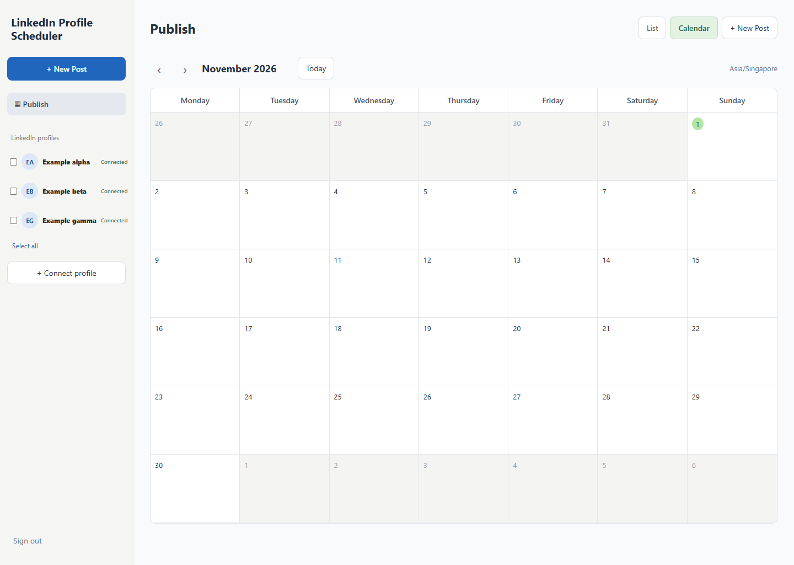

# LinkedIn Profile Scheduler

An open-source, self-hosted alternative to the basic LinkedIn scheduling workflow. Connect multiple **personal LinkedIn profiles**, write a post once, select the profiles, and schedule it across them.

Built by Daniel. Free to use under the MIT License. **Not affiliated with LinkedIn or Buffer.**



## What it does

- Connect multiple personal LinkedIn profiles through LinkedIn's official OAuth authorization.
- Schedule one text post across multiple selected profiles.
- Attach **one** image, document, or video to each scheduled post (the app uploads a separate private copy for each selected profile).
- Calendar and list views, status tracking, a preview, and password-protected access.
- Remove our uploaded media after LinkedIn confirms publication. Uncertain outcomes are held for review instead of blindly retrying.

**Not included:** Facebook, LinkedIn Company Pages, analytics, carousel creation, multiple attachments in a single post, multiple independent app users, or one-click hosting. **You supply your own LinkedIn developer credentials and hosting.**

## Quick start (Windows, Mac, or Linux)

You need **Node.js 22 or newer**, a LinkedIn account, and your **own LinkedIn developer application**.

### 1. Download this project

On this GitHub page, click **Code → Download ZIP**, then unzip it. Alternatively, clone the repository with Git.

### 2. Get your own LinkedIn API credentials

Follow [GET_YOUR_LINKEDIN_API.md](docs/GET_YOUR_LINKEDIN_API.md). You'll create your own developer app and enable two self-service products. **Do not use anybody else's Client ID or Client Secret.**

### 3. Create your private settings file

Copy `.env.example` to a file named `.env` in the project folder.

On Windows, open PowerShell in the project folder and run:

```powershell
Copy-Item .env.example .env
```

On Mac/Linux:

```sh
cp .env.example .env
```

Open `.env` in a text editor. Fill in:

- `ADMIN_PASSWORD`: a long, unique password for signing into your scheduler.
- `LINKEDIN_CLIENT_ID`: your developer app's Client ID.
- `LINKEDIN_CLIENT_SECRET`: your developer app's Client Secret.
- `TOKEN_ENCRYPTION_KEY`: generate a random 32-byte encryption key using the command below.

To generate the encryption key, run:

```sh
node -e "console.log(require('node:crypto').randomBytes(32).toString('base64'))"
```

Copy the output into `TOKEN_ENCRYPTION_KEY=` in `.env`. Keep the key private and backed up securely; losing it means reconnecting LinkedIn accounts.

The default redirect URL is `http://localhost:3000/auth/linkedin/callback`. Add that **exact URL** to your LinkedIn app's Auth tab.

### 4. Start the app

Open a terminal in the project folder and run:

```sh
node --env-file=.env src/start.mjs
```

Open **http://localhost:3000** in your browser and sign in using your `ADMIN_PASSWORD`.

Click **Connect profile**, sign in to LinkedIn if prompted, and approve the permissions. Repeat for other personal profiles you manage.

### 5. Start the scheduled publishing worker

Open **another terminal** in the same folder and run:

```sh
node --env-file=.env src/worker-start.mjs
```

**Keep both terminals running** to publish scheduled posts. If your PC is off or asleep, local scheduling stops. To publish 24/7, use a continuously running server with persistent storage; see [HOSTING.md](docs/HOSTING.md).

### 6. Schedule your first post

Select one or more connected profiles using the checkboxes, click **New Post**, write your text, optionally attach a file, choose a future time, and click **Schedule Posts**. A separate job is created for each selected profile.

**First test:** Schedule a harmless post to a profile you own, and verify it appears on LinkedIn. Publishing creates a **public LinkedIn post**.

## Security and limitations

- Never upload your `.env`, `.sqlite` databases, media files, access tokens, or secrets to GitHub. They are excluded by `.gitignore`.
- This is a **single-admin application**. Anyone with its website address and admin password can schedule posts on **all connected profiles**. Use HTTPS and a strong password if you host it online.
- Your LinkedIn access tokens expire. Reconnect profiles when the app reports expiration.
- Uploaded files are kept privately until publication succeeds; failed or uncertain jobs retain their files. For videos, large files and media processing may have API restrictions.
- The app limits attachments to one per post and currently accepts JPG/PNG/GIF (up to 20 MB), PDF/DOC/DOCX/PPT/PPTX/MP4/MOV (up to 25 MB).
- A publishing response lost in transit can leave a job marked **uncertain**. Check LinkedIn manually before trying again to avoid duplicate posts.
- LinkedIn's API versions and policies can change. Some advanced permissions need LinkedIn approval; the personal-profile posting scope is currently offered through the self-service **Share on LinkedIn** product.
- The **Sites/Cloudflare adapter** in `src/sites-worker.mjs` is provided for developers, but has not been verified on a live deployment. It requires D1, R2, secure secrets and a cloud scheduler. See [HOSTING.md](docs/HOSTING.md).

## Run automated tests

```sh
npm run test:twice
```

The tests simulate LinkedIn responses. **Passing tests does not mean a live LinkedIn connection or cloud deployment is verified.**

## Need help setting it up with AI?

Copy the instructions in [AI_SETUP_PROMPT.md](docs/AI_SETUP_PROMPT.md) into your AI assistant. It will guide you through the developer app, local setup, testing, and hosting without asking you to share your Client Secret.

## License

MIT — see [LICENSE](LICENSE). LinkedIn and Buffer are trademarks of their respective owners.
